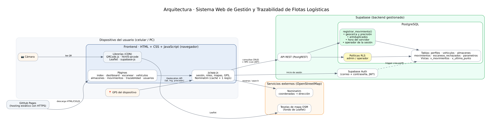
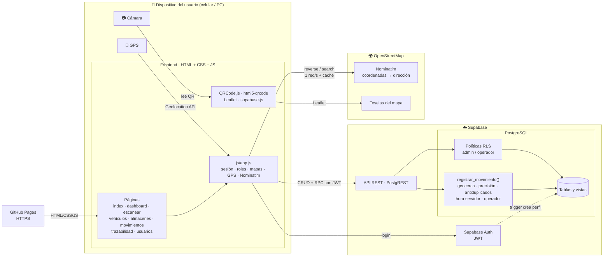
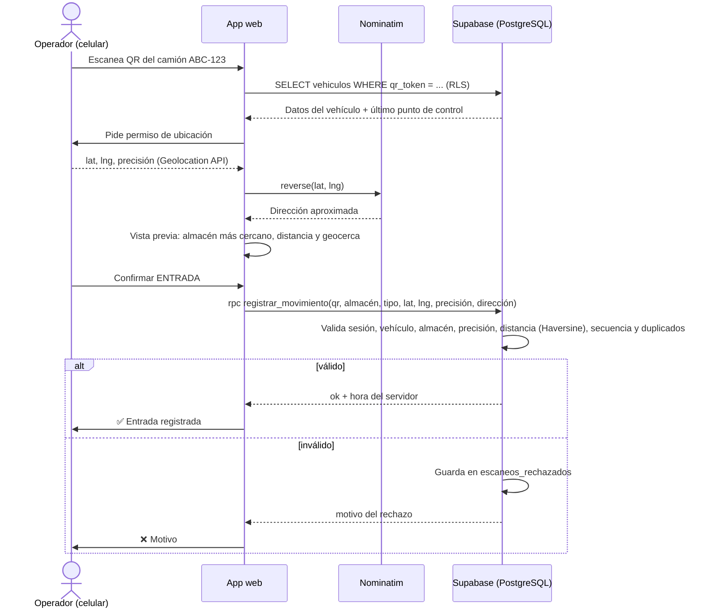

# Diagrama de arquitectura

## Versión Mermaid (GitHub la dibuja automáticamente)

## Componentes

| Capa | Tecnología | Responsabilidad |
|---|---|---|
| Hosting | GitHub Pages | Sirve los archivos estáticos con HTTPS (requisito para la cámara y el GPS) |
| Interfaz | HTML5, CSS3 responsive, JavaScript | Pantallas, formularios, validación previa, mapas |
| Identificación | QRCode.js / html5-qrcode | Generar el QR único del vehículo y leerlo con la cámara (o desde una imagen) |
| Ubicación | Geolocation API | Latitud, longitud y precisión del **dispositivo que escanea** |
| Dirección | Nominatim (OSM) | Convertir coordenadas en dirección aproximada; buscar direcciones de almacenes |
| Mapas | Leaflet + teselas OSM | Almacenes, geocercas, puntos de control y recorridos |
| Autenticación | Supabase Auth | Correo y contraseña; sesión con JWT |
| Datos | PostgreSQL (Supabase) | Tablas, vistas, restricciones e integridad referencial |
| Seguridad | RLS + funciones `SECURITY DEFINER` | Permisos por rol; validación de reglas de negocio en el servidor |

## Flujo del caso principal (registrar llegada)

## Decisiones de diseño
- **La validación definitiva se hace en el servidor.** El navegador muestra una vista previa de la geocerca, pero la distancia, la hora y el operador se calculan en PostgreSQL: así un usuario no puede falsificarlos modificando el JavaScript.
- **Trazabilidad por puntos de control.** El sistema guarda el **último punto de control registrado**; no es seguimiento GPS en tiempo real. El GPS identifica al dispositivo que escanea, no prueba la ubicación física del vehículo.
- **QR con token aleatorio (UUID)** en lugar de la placa: no se puede adivinar ni fabricar un QR válido solo conociendo la placa, y el admin puede invalidarlo regenerándolo.
- **Sin servidor propio:** todo el backend está en Supabase, de modo que se puede publicar en GitHub Pages.
