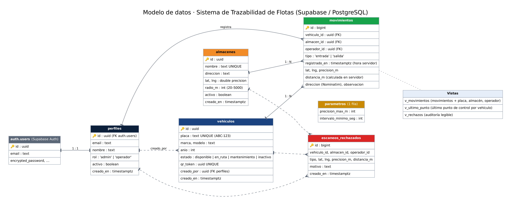
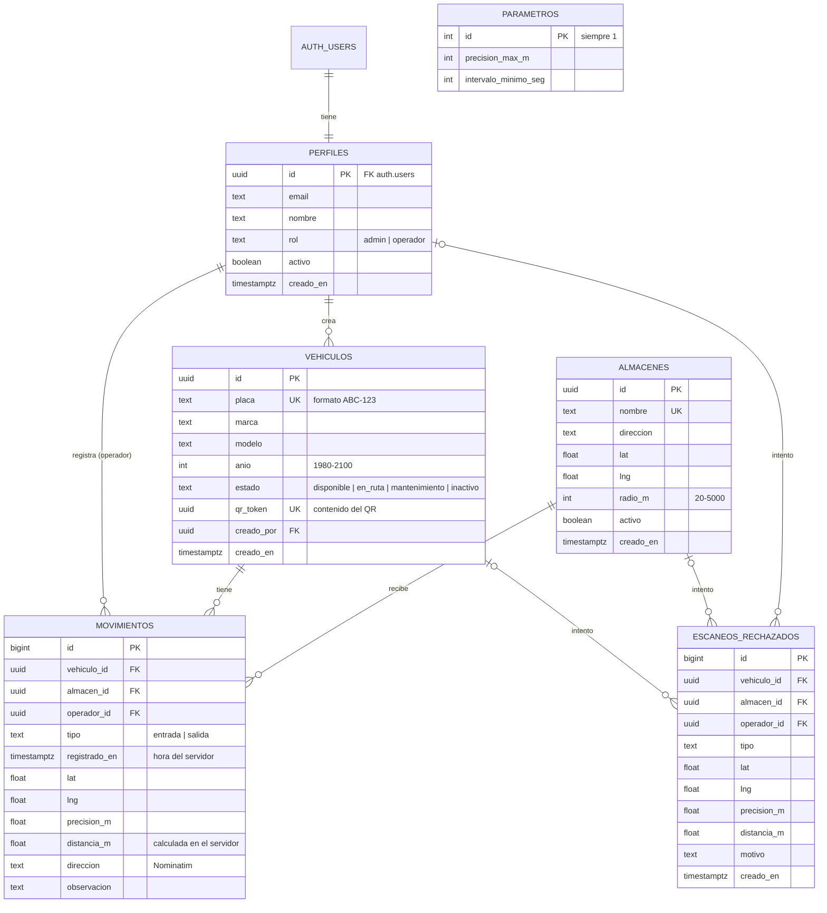

# Modelo de datos

Base de datos **PostgreSQL** gestionada por **Supabase**. Script completo: [`sql/01_esquema_y_seguridad.sql`](../sql/01_esquema_y_seguridad.sql).

## Diagrama entidad-relación (Mermaid; GitHub lo dibuja automáticamente)

## Diccionario de datos

### `perfiles`
Extiende `auth.users` (Supabase Auth) con el nombre y el **rol**. Se crea automáticamente con un *trigger* al registrarse un usuario. El **primer** usuario es `admin`; los siguientes, `operador`.

| Campo | Tipo | Reglas |
|---|---|---|
| id | uuid | PK, FK a `auth.users`, borrado en cascada |
| email | text | obligatorio |
| nombre | text | obligatorio |
| rol | text | `admin` o `operador` |
| activo | boolean | un usuario desactivado no puede usar el sistema |

### `vehiculos` (RF02, RF03)
| Campo | Tipo | Reglas |
|---|---|---|
| placa | text | única, formato `^[A-Z0-9]{3}-[0-9]{3}$` |
| marca / modelo | text | obligatorios |
| anio | int | entre 1980 y 2100 |
| estado | text | `disponible`, `en_ruta`, `mantenimiento`, `inactivo`. Se actualiza solo: entrada → `disponible`, salida → `en_ruta` |
| qr_token | uuid | único, generado por el servidor. El QR contiene `FLOTA-QR:<qr_token>`. Solo cambia con `regenerar_qr()` |

### `almacenes` (RF04)
| Campo | Tipo | Reglas |
|---|---|---|
| nombre | text | único |
| direccion | text | obligatoria (se puede obtener con Nominatim) |
| lat / lng | double | rangos válidos de coordenadas |
| radio_m | int | radio de la geocerca, entre 20 y 5000 m |
| activo | boolean | los inactivos no aceptan movimientos |

### `movimientos` (RF09)
Solo se escriben a través de `registrar_movimiento()`. `registrado_en` = `now()` del servidor; `operador_id` = `auth.uid()`; `distancia_m` = Haversine calculado en PostgreSQL. Las FK con `ON DELETE RESTRICT` impiden borrar vehículos o almacenes con historial.

### `escaneos_rechazados`
Auditoría de cada intento rechazado, con su motivo (fuera de geocerca, mala precisión, duplicado, vehículo inactivo, QR inválido, etc.). Solo visible para admin.

### `parametros`
Una única fila con `precision_max_m` (por defecto 100 m) e `intervalo_minimo_seg` (por defecto 60 s). Editable por el admin.

## Vistas
| Vista | Uso |
|---|---|
| `v_movimientos` | Movimientos con placa, almacén y operador (historial) |
| `v_ultimo_punto` | Último movimiento de cada vehículo (RF10: último punto de control, **no** GPS en tiempo real) |
| `v_rechazos` | Auditoría legible de rechazos |

Todas usan `security_invoker = true`, así que respetan las políticas RLS del usuario que consulta.

## Funciones (lógica en el lado seguro)
| Función | Quién | Qué hace |
|---|---|---|
| `registrar_movimiento(qr, almacén, tipo, lat, lng, precisión, dirección, observación)` | autenticados activos | Valida y registra entrada/salida (ver reglas abajo) |
| `regenerar_qr(vehículo)` | admin | Nuevo `qr_token`: invalida el QR impreso anterior |
| `admin_actualizar_usuario(id, rol, activo)` | admin | Cambia rol/estado; no permite quitarse el admin a sí mismo |
| `es_admin()`, `es_activo()` | interno | Usadas por las políticas RLS |
| `distancia_m(...)` | interno | Fórmula de Haversine en metros |

### Reglas de negocio de `registrar_movimiento()`
1. Sesión iniciada y usuario activo.
2. El QR corresponde a un vehículo; el vehículo no está *inactivo* ni en *mantenimiento*.
3. El almacén existe y está activo.
4. Precisión GPS ≤ `precision_max_m`.
5. Distancia (calculada en el servidor) ≤ `radio_m` del almacén.
6. No hay un movimiento del mismo vehículo en los últimos `intervalo_minimo_seg` segundos.
7. Secuencia lógica: no hay dos **entradas** seguidas; una **salida** debe ser del mismo almacén de la última entrada; tras una salida, lo siguiente debe ser una entrada.
8. Bloqueo de la fila del vehículo (`FOR UPDATE`) para evitar dobles registros simultáneos.
9. Si todo es válido, inserta el movimiento con la hora del servidor y el operador de la sesión, y actualiza el estado del vehículo. Si no, guarda el rechazo y devuelve el motivo.

## Políticas RLS
| Tabla | Leer | Crear / Editar / Eliminar |
|---|---|---|
| perfiles | usuarios activos (y cada uno su propio perfil) | solo vía función (admin) |
| vehiculos | usuarios activos | admin |
| almacenes | usuarios activos | admin |
| movimientos | usuarios activos | **nadie directamente**: solo `registrar_movimiento()` |
| escaneos_rechazados | admin | nadie directamente |
| parametros | usuarios activos | admin (editar) |

El rol `anon` (visitante sin sesión) no tiene acceso a ninguna tabla.
